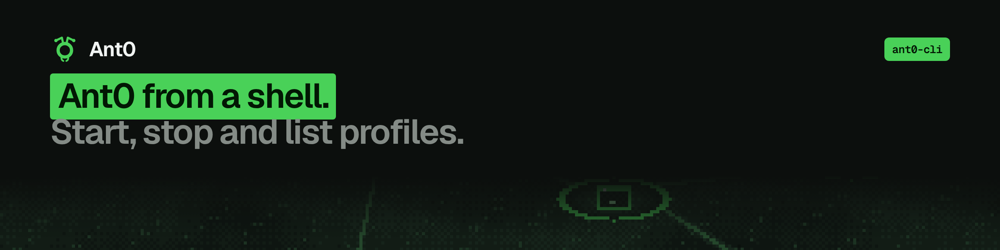

<p align="center">
  <a href="https://ant0.link"></a>
</p>

<p align="center">
  <a href="LICENSE"></a>
  <a href="https://www.npmjs.com/package/ant0"></a>
  <a href="https://docs.ant0.link/cli"></a>
</p>

# Ant0 CLI

**The `ant0` command line. Start, stop and list Ant0 browser profiles from a shell.**

When a profile starts, `ant0` prints its DevTools WebSocket, so Playwright or any other CDP client
can connect. The same tool also runs the [Ant0 MCP server](https://github.com/Ant0-Browser/ant0-mcp)
(`ant0 mcp serve --stdio`).

> Part of [Ant0](https://ant0.link), a browser for automation and agents. The CLI talks to the Ant0
> app on your computer. The app is free for 5 profiles and needs a free account.

## Requirements

- The Ant0 app, installed, running and signed in: [download](https://ant0.link/download). It runs on
  Windows 10 or 11 (64-bit) and 64-bit Ubuntu 24.04 or Debian 13 or newer.
- Node.js 24 or newer, to run the npm package. The Ant0 app also includes an `ant0` command that needs no separate Node.js.

The CLI doesn't start the app or sign in for you. `ant0 daemon start` starts the background daemon
(`ant0d`) that the app installs, and `ant0 login` signs in from a terminal.

## Install

```bash
npm install --global ant0
ant0 --version
```

The npm package version follows the Ant0 app release it was built from. `ant0 daemon start` and
`ant0 daemon status` warn when the running daemon's major.minor version differs from the CLI's.
`ant0 daemon start` looks for the daemon in `ANT0D_BIN`, then on `PATH`, then where the app installs it.

## Quickstart

```bash
ant0 profiles ls
ant0 profiles start "Shop DE"   # prints the DevTools WebSocket
ant0 profiles stop "Shop DE"
```

`ant0` finds the app through the Ant0 data folder. Use `--home` (or `ANT0_HOME`) for a different
folder, and `--port` (or `ANT0D_PORT`) for a different port. Add `--json` for machine-readable output.

To give a script less access than the app's own token, use an API key with only the scopes it needs:
`--credential-file <path>`, or the `ANT0_API_KEY` environment variable.

## Commands

| Command                                 | What it does                                            |
| --------------------------------------- | ------------------------------------------------------- |
| `daemon`                                | Start, stop and inspect the local daemon                |
| `browsers`                              | Installed Ant0 Browser releases                         |
| `profiles`                              | Create, edit, start and stop browser profiles           |
| `trash`                                 | Profiles waiting in the trash                           |
| `proxies`                               | Shared proxies                                          |
| `extensions`                            | The extension library shared by profiles                |
| `events`                                | Tail the event stream                                   |
| `login`, `logout`, `account`, `licence` | Sign in and out, and show the account and licence state |
| `workspace`                             | List and select account workspaces                      |
| `sync`                                  | Encrypted profile sync and transfers                    |
| `team`                                  | Folders, members and invitations                        |
| `api-keys`, `key-status`                | Manage delegated API keys and read their status         |
| `mcp`                                   | Serve the local MCP server (`ant0 mcp serve --stdio`)   |

Run `ant0 <command> --help` for the subcommands and options.

## Documentation

- [CLI and MCP guide](https://docs.ant0.link/cli)
- [API reference](https://docs.ant0.link/api)
- [All docs](https://docs.ant0.link) · [Changelog](https://ant0.link/changelog)

## Support

Questions and bugs go in [Issues](../../issues). For your account or billing, use the
[contact page](https://ant0.link/contact).

## Security

Please don't report security problems in public issues. See the organisation's
[security policy](https://github.com/Ant0-Browser/.github/blob/main/SECURITY.md), or use
**Security → Report a vulnerability** on this repository.

## Licence

BSD-3-Clause. See [LICENSE](LICENSE).

The Ant0 app, the Ant0 Browser engine and the Ant0 cloud service are proprietary and not covered by
this licence.
